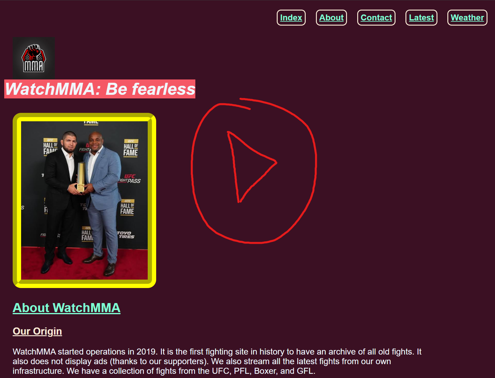

  Welcome to this repository. I'm surprised you're here. But since you're here, let me tell you what this is...

  It's a hand-coded frontend project which I coded with my own hands. It has everything one can dream of: CSS, HTML, and Javascript.

  This "project" was part of a course at my university. It's a fictional website for watching the latest MMA fights (no piracy 🏴‍☠️). 
  Supports feedback through a form and has an API to fetch the latest weather(Use my API, idc). 

<h2>Features:</h2>
<ol>
  <li> Feedback through feedback forms</li>
  <li> Latest weather fetch through latitude and longitude input</li>
  <li> Nice layout 😃</li>
</ol>

This website was built using <mark>HTML</mark>, <mark>CSS</mark> and <mark>Javascript</mark>.

<strong>Watch the Demo on YT 👇👇</strong>

  

